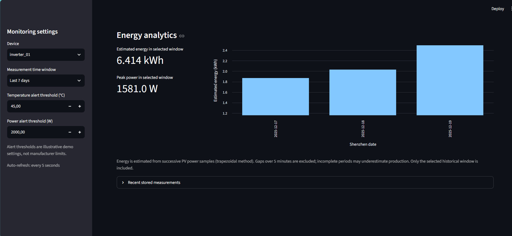
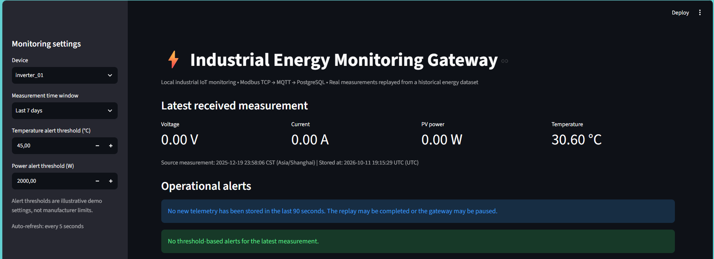
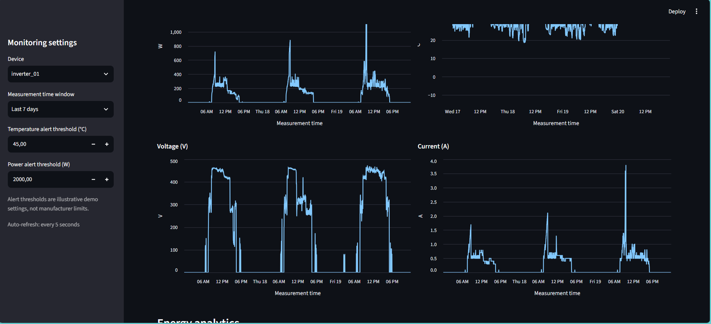

# Industrial Energy Monitoring Gateway

A local, Python-based industrial IoT demonstration that replays real photovoltaic inverter measurements through **Modbus TCP**, bridges them to **MQTT**, persists them in **PostgreSQL**, and visualizes them in a **Streamlit** dashboard.

The project models a practical telemetry pipeline rather than importing a CSV directly into a database. It includes application-level database acknowledgments, resumable replay, duplicate protection, historical charts, estimated PV energy production, and configurable demo alerts.

## Dashboard Preview

The screenshots below show the actual Streamlit dashboard running locally.

<p align="center">
  
</p>

<p align="center">
  
  
</p>
## Architecture

```text
OpenCEM historical PV measurements (CSV)
                 |
                 v
 Python virtual inverter / Modbus TCP server (127.0.0.1:5020)
                 |  Holding registers (voltage, current, power,
                 |  temperature, source timestamp, sequence)
                 v
 Python Modbus-to-MQTT gateway
                 |  MQTT QoS 1: energy/inverter_01/telemetry
                 v
 Mosquitto MQTT broker (127.0.0.1:1883)
                 |
                 v
 Python MQTT database subscriber ---> PostgreSQL (127.0.0.1:5432)
                 |                         |
                 | MQTT ACK after          v
                 | successful commit    Streamlit dashboard
                 v                       (127.0.0.1:8501)
 Gateway writes ACK to Modbus registers 12-13
                 |
                 v
 Virtual inverter checkpoints and advances to next measurement
```

The application runs locally. No cloud deployment is required.

## Technology stack

- **Python / pandas:** dataset preprocessing and telemetry replay
- **PyModbus / Modbus TCP:** simulated industrial device and gateway communication
- **Eclipse Mosquitto / Paho MQTT:** message broker, telemetry transport, and acknowledgment messages
- **PostgreSQL / psycopg:** durable, queryable measurement storage
- **Streamlit:** automatically refreshed monitoring dashboard and historical analytics
- **python-dotenv:** local configuration without credentials in source code

## Dataset

The included `data/telemetry_sample.csv` is a processed subset of the public [OpenCEM Dataset](https://github.com/OpenCEM-platform/opencem-dataset), derived from the inverter measurement partition [`2025-12-b.csv`](https://github.com/OpenCEM-platform/opencem-dataset/blob/main/data/measurements/2025-12-b.csv).

- Source: real campus PV-and-battery microgrid measurements from CUHK-Shenzhen.
- Selection: inverter 1, December 17–19, 2025 (Asia/Shanghai), approximately one sample every two minutes.
- Demo subset: 2,160 rows with PV voltage (`pv1volt`), current (`pv1curr`), power (`pv1power`), and temperature (`temper1`).
- The original **measurement timestamp** is preserved and is distinct from the later **database receive timestamp**.
- The finite CSV is replayed at an accelerated rate; this demonstration is **not** a live connection to the physical microgrid.

Please see [DATA_ATTRIBUTION.md](DATA_ATTRIBUTION.md) for source, license, and academic attribution.

## Project files

| Path | Purpose |
| --- | --- |
| `data/telemetry_sample.csv` | Prepared replay dataset (include it in the GitHub repository) |
| `device_simulator.py` | Modbus TCP inverter simulator and persistent replay checkpoint |
| `modbus_mqtt_gateway.py` | Modbus polling, MQTT publish, and ACK forwarding |
| `mqtt_subscriber.py` | MQTT subscriber and PostgreSQL inserts |
| `dashboard.py` | Monitoring dashboard, charts, energy analytics, demo alerts |
| `verify_telemetry.py` | Compare source measurement timestamps with database records |
| `schema.sql` | Database table and uniqueness constraint |
| `.env.example` | Safe database configuration template |
| `requirements.txt` | Python dependencies |
| `prepared_dataset.py` | Dataset preparation helper |
| `modbus_client.py` | Optional direct Modbus inspection tool |

The simulator saves its local progress in `data/simulator_state.json`. That file is machine-specific and excluded from version control.

## Prerequisites

- Python 3.12 or later (use a compatible supported Python version for the pinned requirements)
- PostgreSQL (tested locally with version 18)
- Mosquitto MQTT broker (port `1883`)
- The repository's sample CSV and Python dependencies

The examples below use **PowerShell on Windows**. On other operating systems, use the corresponding service manager and `python -m venv` activation or virtual-environment Python path.

### 1. Download and install the Python dependencies

```powershell
git clone https://github.com/sulec0skun/industrial-energy-monitoring-gateway.git
cd industrial-energy-monitoring-gateway
python -m venv .venv
.\.venv\Scripts\python.exe -m pip install -r requirements.txt
```

### 2. Start PostgreSQL and Mosquitto

If PostgreSQL was installed as a Windows service, check its actual service name:

```powershell
Get-Service *postgres*
Get-Service mosquitto
```

Start stopped services from **Administrator PowerShell** with their actual names, for example:

```powershell
Start-Service mosquitto
# Start-Service <your-postgresql-service-name>
```

**Development environment note:** The project was also tested using PostgreSQL 18 initialized in the Windows user profile, *not* as a Windows service. For that specific layout only:

```powershell
$pgCtl = "C:\Program Files\PostgreSQL\18\bin\pg_ctl.exe"
$dataDir = "$env:LOCALAPPDATA\PostgreSQL\18\data"
& $pgCtl status -D $dataDir
# If it is stopped:
& $pgCtl -D $dataDir -l "$env:LOCALAPPDATA\PostgreSQL\18\server.log" start
```

Mosquitto is checked with `Get-Service mosquitto` and started with `Start-Service mosquitto` if needed.

### 3. Create the database and its table

Using `psql` (add PostgreSQL's `bin` directory to `PATH` if needed):

```powershell
psql -h 127.0.0.1 -U postgres -d postgres -c "CREATE DATABASE energy_monitoring;"
psql -h 127.0.0.1 -U postgres -d energy_monitoring -v ON_ERROR_STOP=1 -f .\schema.sql
```

If the database already exists, skip the `CREATE DATABASE` statement. You may instead use pgAdmin to create the database and run `schema.sql` in its Query Tool.

### 4. Configure the database connection

```powershell
Copy-Item .env.example .env
```

Open `.env` locally and fill in your own `DB_PASSWORD` (and other settings if necessary). **Never commit or share `.env`.** The default database name is `energy_monitoring`.

### 5. Start the telemetry pipeline

Leave these programs running in **three separate terminals**, in this order:

**Terminal 1 — database subscriber**

```powershell
.\.venv\Scripts\python.exe mqtt_subscriber.py
```

**Terminal 2 — virtual Modbus device**

```powershell
.\.venv\Scripts\python.exe device_simulator.py
```

**Terminal 3 — Modbus-to-MQTT gateway**

```powershell
.\.venv\Scripts\python.exe modbus_mqtt_gateway.py
```

The gateway will publish measurements as MQTT JSON messages, the subscriber will store them, and the inverter will advance after the database confirmation returns via MQTT and Modbus.

**Terminal 4 — monitoring dashboard**

```powershell
.\.venv\Scripts\python.exe -m streamlit run dashboard.py --server.address 127.0.0.1 --server.port 8501
```

Open <http://localhost:8501>.

The dashboard can display previously stored data with only PostgreSQL running. New live replay measurements require all three pipeline processes and the MQTT broker.

### 6. Verify database persistence

After the replay completes:

```powershell
.\.venv\Scripts\python.exe verify_telemetry.py
```

For the included subset, a complete first run should show:

```text
Expected measurements: 2160
Stored measurements: 2160
Missing measurements: 0
Unexpected measurements: 0
Data complete: True
```

You can also inspect records directly:

```sql
SELECT COUNT(*) FROM telemetry;

SELECT device_id, measurement_timestamp, received_timestamp,
       voltage, current, power, temperature
FROM telemetry
ORDER BY id DESC
LIMIT 10;
```

The timestamp comparison tool checks that expected source timestamps are present. It does not perform a separate byte-for-byte audit of every numerical measurement.

## MQTT contract

- Broker: `127.0.0.1:1883`
- Telemetry topic: `energy/inverter_01/telemetry`
- Database ACK topic: `energy/inverter_01/ack`
- QoS: `1` for telemetry and acknowledgments

Example telemetry payload (illustrative values):

```json
{
  "device_id": "inverter_01",
  "measurement_timestamp": "2025-12-17T04:00:00+00:00",
  "published_timestamp": "2026-10-12T06:30:00+00:00",
  "sequence_number": 361,
  "voltage": 420.5,
  "current": 0.4,
  "power": 167.0,
  "temperature": 36.1
}
```

The subscriber publishes an ACK containing the same device, measurement timestamp, and sequence number **only after** the PostgreSQL transaction has committed (or the record is already present).

## Modbus holding registers

All offsets below are **zero-based**. Two 16-bit registers hold each value; float32 and uint32 values use high word first.

| Holding register offsets | Type | Meaning |
| --- | --- | --- |
| 0–1 | float32 | PV voltage (V) |
| 2–3 | float32 | PV current (A) |
| 4–5 | float32 | PV power (W) |
| 6–7 | float32 | Temperature (°C) |
| 8–9 | uint32 | Original Unix measurement time (UTC seconds) |
| 10–11 | uint32 | Replay sequence number |
| 12–13 | uint32 | Last database-confirmed sequence number (gateway writes) |

## Database schema

See [`schema.sql`](schema.sql). The `telemetry` table contains:

`id`, `device_id`, `measurement_timestamp`, `received_timestamp`, `voltage`, `current`, `power`, `temperature`.

A unique constraint on `(device_id, measurement_timestamp)` prevents duplicate records when telemetry messages are retried. Database receive time and source measurement time intentionally remain separate.

## Dashboard features

- Latest stored PV voltage, current, power, and temperature
- Measurement time (Asia/Shanghai) and database receive time (UTC)
- Automatic refresh every 5 seconds
- Historical charts for a selectable measurement-time window
- Estimated PV energy in kWh using the trapezoidal rule, omitting gaps over five minutes
- Configurable example temperature and high-power thresholds
- Informational notice when no new record has been stored for 90 seconds

The dashboard displays selected historical windows, not an exhaustive scan of an indefinitely growing database. Alert thresholds are illustrative, not certified hardware safety limits. A completed finite replay also triggers the "no new telemetry" notice.

## Failure recovery and replay behavior

- **Database or subscriber unavailable:** the simulated inverter waits for a database ACK and retries can occur via the gateway.
- **Lost MQTT ACK:** the measurement may be republished. The database unique constraint makes inserts idempotent.
- **Simulator restarted:** its local checkpoint lets it continue from the last acknowledged record.
- **Duplicate telemetry:** ignored by the database insert and acknowledged again.
- **After all source rows are processed:** the finite simulator stays online but stops producing new measurements.

For a **fresh installation**, no checkpoint file is present and the replay starts from the beginning. To manually replay the same CSV on a computer that has already completed it, stop the simulator and remove its local `data/simulator_state.json` checkpoint. **This does not clear PostgreSQL**, and duplicate timestamps will not create new database rows. If you need a genuinely empty demonstration database, create a *separate* empty database and apply `schema.sql`; do not delete a user's existing data.

### Known limits

This is a controlled local prototype, **not** a production industrial historian or a direct connection to an inverter. The acknowledgment loop improves the simulated pipeline's delivery behavior, but does not offer a universal exactly-once guarantee, a persistent device history for real hardware, MQTT authentication/TLS, or resilience against every power/storage failure. There is no cloud hosting. The shipped source CSV is a finite demo, not an infinite live feed.

## Stopping the project

Use `Ctrl+C` in each Python terminal. PostgreSQL data persists after the processes stop. The database and broker can be stopped separately using the relevant operating-system service controls.

## Data license and attribution

This project uses an attributed subset of the [OpenCEM Dataset](https://github.com/OpenCEM-platform/opencem-dataset). The upstream repository contains an MIT software license; the dataset's metadata identifies its data license as **CC BY 4.0**. See [DATA_ATTRIBUTION.md](DATA_ATTRIBUTION.md) for details and the associated paper.
